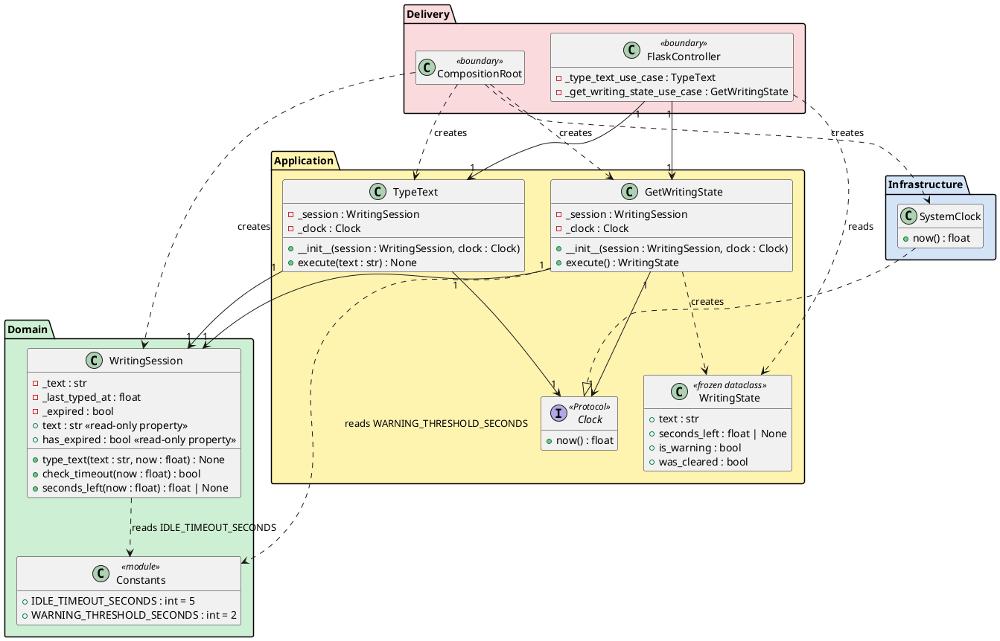
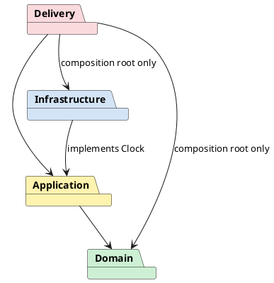

# Design Class Diagram

## Metadata
| Key | Value |
| --- | --- |
| ID | DCD-002 |
| CrossReference | [DM-002], [DCD-001], [SD-001], [SA-001] |

## Version History
| Date | Status | Author | Reviewer | Change | Commit |
| --- | --- | --- | --- | --- | --- |
| 2026-11-20 | Accepted | Jens Tirsvad Nielsen | S01 | Initial version: classes of UC-001 added from [DCD-001] | pending |

---

## Purpose and Scope

The consolidated Design Class Diagram of the project. It covers the use cases that exist so far: UC-001 (Write without stopping), whose own diagram is [DCD-001]; the classes below refine the concepts of the project Domain Model [DM-002]. It turns the sequence diagrams of [SD-001] into design classes in the four layers of Clean Architecture, under `src/disappearing_text/`. It answers concern CN-001 (text must disappear after more than 5 seconds without typing), CN-003 (tests protect the session rules) and CN-004 (readable code with the assignment's function names) of [SA-001], and serves S01 and S02. The Delivery layer is drawn only as the boundary and the composition root; the Flask classes are designed in MIL-003 and then added here.

## Diagram

Package dependencies (all point inward; the interface `Clock` is owned by Application and implemented in Infrastructure):

## Class Table

| Class | Refines (Domain Model concept) | Responsibility | Attributes | Operations |
| --- | --- | --- | --- | --- |
| WritingSession | Writing Session; its attributes `_text` and `_last_typed_at` refine Text and last typing moment, `_expired` refines text lost | Holds the Text and decides when it is deleted, given the time it is told | `-_text`, `-_last_typed_at`, `-_expired` | `+type_text`, `+check_timeout`, `+seconds_left`, `+text`, `+has_expired` |
| Constants | Idle Timeout (length in seconds, warning period in seconds); module of constants, not a class with instances | Holds the Idle Timeout and the warning period in one place | `+IDLE_TIMEOUT_SECONDS`, `+WARNING_THRESHOLD_SECONDS` | none |
| Clock | None: technical port | States what the use cases need from time: the current moment in seconds | none | `+now` |
| TypeText | None: technical use case object | Carries the system operation `type_text` from the Presentation to the Writing Session | `-_session`, `-_clock` | `+__init__`, `+execute` |
| GetWritingState | None: technical use case object | Carries the system operation `get_state`: checks the timeout, then builds the answer | `-_session`, `-_clock` | `+__init__`, `+execute` |
| WritingState | None: data transfer object for the state of the Writing Session (Text, seconds left, Warning, Text was cleared) | Carries the state to the Presentation | `+text`, `+seconds_left`, `+is_warning`, `+was_cleared` | none |
| SystemClock | None: technical adapter | Implements `Clock` with the monotonic system clock | none | `+now` |
| FlaskController | None: technical boundary (MIL-003) | Maps requests to the two use cases | `-_type_text_use_case`, `-_get_writing_state_use_case` | designed in MIL-003 |
| CompositionRoot | None: technical boundary (MIL-003) | Creates the one Writing Session, the clock and the use cases, and connects them | none | designed in MIL-003 |

Idle Timeout and Text are not classes of their own. Idle Timeout has two values and no behaviour, so it is two constants; Text is the one string `_text` that the Writing Session owns. Neither is dropped: the table above shows where each lives.

## Method Traceability

| Method signature | Operation Contract / SD message |
| --- | --- |
| `WritingSession.type_text(text : str, now : float) : None` | `type_text` in [OC-001]; message `type_text(text, now)` in sequence type_text of [SD-001] |
| `WritingSession.check_timeout(now : float) : bool` | `get_state` in [OC-001] (the internal check); message `check_timeout(now)` in sequence get_state of [SD-001] |
| `WritingSession.seconds_left(now : float) : float or None` | `get_state` in [OC-001], `seconds_left`; message `seconds_left(now)` in sequence get_state |
| `WritingSession.text : str` | `get_state` in [OC-001], `text`; message `text` in sequence get_state |
| `WritingSession.has_expired : bool` | `get_state` in [OC-001], `was_cleared`; message `has_expired` in sequence get_state |
| `TypeText.execute(text : str) : None` | `type_text` in [OC-001]; message `execute(text)` in sequence type_text |
| `GetWritingState.execute() : WritingState` | `get_state` in [OC-001]; message `execute()` in sequence get_state |
| `Clock.now() : float` and `SystemClock.now() : float` | message `now()` in sequences type_text and get_state |
| `TypeText.__init__` and `GetWritingState.__init__` | message `create(session, clock)` in sequence composition at start |
| `WritingState` fields | `create(text, seconds_left, is_warning, was_cleared)` in sequence get_state; return of `get_state` in [OC-001] |

## Pattern Annotations

| Pattern | Classes | Rationale |
| --- | --- | --- |
| Ports and Adapters (Dependency Inversion) | `Clock`, `SystemClock` | Application owns the interface; Infrastructure implements it, so tests use a fake clock |
| Controller (GRASP) | `TypeText`, `GetWritingState` | Each receives one system operation and coordinates, without holding the rule |
| Information Expert (GRASP) | `WritingSession` | It owns the data the timeout rule needs |
| Data Transfer Object | `WritingState` | A frozen value hides the domain object from the Presentation |
| Dependency Injection | `CompositionRoot`, `TypeText`, `GetWritingState` | One shared `WritingSession` and the clock are passed in; this is not a Singleton, because no class enforces a single instance |
| Pure Fabrication (GRASP) | `SystemClock`, `Constants` | They have no Writer-world meaning and keep time and numbers out of the rules |

## Dependency Check

Every dependency points inward: Delivery depends on Application and Domain, Application depends on Domain, and Infrastructure depends on Application through the `Clock` interface, which Application owns. The Domain classes depend only on the Constants module in the same layer: `WritingSession` imports no Flask and no clock. The Delivery to Infrastructure arrow exists only for `CompositionRoot`, which creates `SystemClock`; no other Delivery class uses it. There are no circular dependencies between classes or packages. SOLID: every class has one responsibility, `TypeText` and `GetWritingState` are split so that neither does two jobs, and the use cases depend on the `Clock` abstraction, not on `SystemClock`.

---

[DM-002]: ./domain-model.md
[DCD-001]: ./use-cases/uc-001/dcd.md
[SD-001]: ./use-cases/uc-001/sd.md
[OC-001]: ./use-cases/uc-001/oc.md
[SA-001]: ./stakeholder-analysis.md
