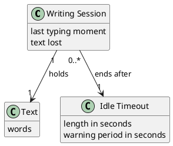

# Domain Model

## Metadata
| Key | Value |
| --- | --- |
| ID | DM-002 |
| CrossReference | [UC-001], [DM-001], [SA-001] |
| Language | en |
| Domain | it |

## Version History
| Date | Status | Author | Reviewer | Change | Commit |
| --- | --- | --- | --- | --- | --- |
| 2026-11-20 | Accepted | Jens Tirsvad Nielsen | S01 | Initial version: concepts of UC-001 added from [DM-001] | [99eebd6] |

---

## Purpose

The consolidated Domain Model of the project. It covers the use cases that exist so far: UC-001 (Write without stopping), whose own model is [DM-001]. It answers concern CN-001 (text must disappear after more than 5 seconds without typing) and supports CN-003 (tests protect the rules) of [SA-001], and serves S01, the Writer, and S02, who reads the rules. Names and meanings are the same as in the use case's model; a later use case adds or changes concepts here and keeps this model in step.

Two terms of the use case are deliberately not concepts. The seconds left (the Countdown) is worked out from the last typing moment and the Idle Timeout, so it is not stored data. The Warning is how the system tells the Writer that the end is near; it is a part of the screen and first appears in the Operation Contract, the Sequence Diagram and the Design Class Diagram. What the Warning depends on, the warning period, is an attribute of Idle Timeout.

## Diagram

Concepts, attributes and associations only — no operations.

## Concept Table

| Concept | Definition | Attributes | Source (use case / glossary) |
| --- | --- | --- | --- |
| Writing Session | One stretch of writing, from the first words the Writer types until the Writer is done or the words are lost. | last typing moment (when the Writer last changed the Text); text lost (whether the Text was lost because the Writer stopped for too long) | UC-001 "Writer opens the application", "Writer keeps typing", "Writer stops typing" |
| Text | The words the Writer has written so far. | words | UC-001 "Text", "types Text", "deletes all of the Text" |
| Idle Timeout | How long the Writer may go without typing before the words are lost, and how near the end the Writer is warned. | length in seconds (5); warning period in seconds (2, the last seconds before the end) | UC-001 "Idle Timeout", "Warning", business rules of steps 4 and 8 |

## Association Table

| From | Association (reading direction) | To | Multiplicity |
| --- | --- | --- | --- |
| Writing Session | holds (a Writing Session holds its Text) | Text | 1 at the Writing Session end, 1 at the Text end |
| Writing Session | ends after (a Writing Session ends after an Idle Timeout) | Idle Timeout | 0..* at the Writing Session end, 1 at the Idle Timeout end |

## Generalizations

| General | Specializations | Is-a justification |
| --- | --- | --- |
| None | None | The three concepts are not kinds of one another |

---

[UC-001]: ./use-cases/uc-001/uc.md
[DM-001]: ./use-cases/uc-001/dm.md
[SA-001]: ./stakeholder-analysis.md
[99eebd6]: https://git.tirsystem.com/Tirsvad-Udemy-100-days-of-code/090-assignment-disappearing-text-writing-app/commit/99eebd69b73173ca68a4d9676c39855a30cdf1b9
