# Project Plan

## Metadata
| Key | Value |
| --- | --- |
| ID | PP-001 |
| CrossReference | [BC-001], [SA-001], [MIL-001], [MIL-002], [MIL-003], [MIL-004] |
| Language | en |
| Domain | it |

## Version History
| Date | Status | Author | Reviewer | Change | Commit |
| --- | --- | --- | --- | --- | --- |
| 2026-11-20 | Accepted | Jens Tirsvad Nielsen | S01 | Initial version | pending |

---

## Purpose

This plan schedules the four phases that build the disappearing text writing
application, over the one-week window of the Business Case ([BC-001]). One phase
is one branch and one pull request.

## Planning Assumptions

- The plan starts 2026-11-20 and ends by 2026-11-23, inside the one-week window of [BC-001] (source: Business Case constraints).
- Phase length: one day. The course sets about 150 minutes for the assignment itself; the rest is documentation.
- S01 is the Product Owner, developer and reviewer ([SA-001]); a stand-in reviewer is marked as not independent in the review record.
- Mode: autonomous, after S01 accepts this plan in chat (source: the request of S01).
- Build steps used for screenshots and wiki: step 1 empty editor, step 2 typing with countdown, step 3 warning in the last seconds, step 4 text gone.

## Gateway Schedule

| Gateway | Document | Window | Decision date | Owner | Stories | Main deliverable | Milestone |
| --- | --- | --- | --- | --- | --- | --- | --- |
| Foundation | [MIL-001] | 2026-11-20 | 2026-11-20 | S01 | none | Tooling, configuration, README baseline, repository metadata | |
| Core writing session | [MIL-002] | 2026-11-21 | 2026-11-21 | S01 | UC-001 | Designed and tested session rules | |
| Flask web app | [MIL-003] | 2026-11-22 | 2026-11-22 | S01 | UC-001 | Working page with countdown | |
| Docs and delivery | [MIL-004] | 2026-11-23 | 2026-11-23 | S01 | none | Screenshots, README, three-language wiki | |

```plantuml
@startgantt
Project starts 2026-11-20
[Foundation] starts 2026-11-20 and ends 2026-11-20
[Core writing session] starts 2026-11-21 and ends 2026-11-21
[Flask web app] starts 2026-11-22 and ends 2026-11-22
[Docs and delivery] starts 2026-11-23 and ends 2026-11-23
[Foundation Go/No-Go] happens 2026-11-20
[Core Go/No-Go] happens 2026-11-21
[Web Go/No-Go] happens 2026-11-22
[Delivery Go/No-Go] happens 2026-11-23
@endgantt
```



## Scope Coverage

| Business Case scope item | Gateway |
| --- | --- |
| Single-page writing application served by Flask | [MIL-003] |
| Countdown that shows the time left | [MIL-003] |
| Pure Python core for the session rules | [MIL-002] |
| Tests, pyproject, gitignore, constants, Doxygen and Doxyfile | [MIL-001], [MIL-002] |
| README from the framework template and three-language wiki | [MIL-001], [MIL-004] |
| One screenshot per build step | [MIL-004] |
| Static scan with opengrep before each push | [MIL-001], [MIL-004] |

## Dependencies

```
MIL-001 → MIL-002 → MIL-003 → MIL-004
```

A No-Go on a phase moves every later gateway and the end date by the time of the rework; the one-week window of [BC-001] allows about two days of slip. S01 decides a move of the end date.

## Plan Risks

| Risk | Impact | Mitigation |
| --- | --- | --- |
| Design artifacts for UC-001 take longer than the code | Medium | Only one use case and no ERD, because nothing is stored |
| Docker screenshot tooling fails on Windows | Medium | Use a Linux container with a headless browser; fall back to Windows Sandbox and report it |
| Translations delay delivery (from the drift risk of [BC-001]) | Low | English first, translations as separate tasks in the last phase |

## Open Issues

- The Day 90 assignment names no functions; function names are taken from the assignment's wording (type text, check timeout, clear text) and S01 may rename them.
- KPI, Business Model Canvas and BPMN are skipped for a one-assignment project; the reason is recorded in an ADR in [MIL-001].
- The framework requires a prompt log under `docs/ai-prompts/`; the folder name contains the word the Product Owner does not want in artifacts, so the log is kept locally and ignored by git. S01 may decide otherwise.

---

[BC-001]: ./business-case.md
[SA-001]: ./stakeholder-analysis.md
[MIL-001]: ./milestones/mil-001-foundation.md
[MIL-002]: ./milestones/mil-002-core-writing-session.md
[MIL-003]: ./milestones/mil-003-flask-web-app.md
[MIL-004]: ./milestones/mil-004-docs-and-delivery.md
