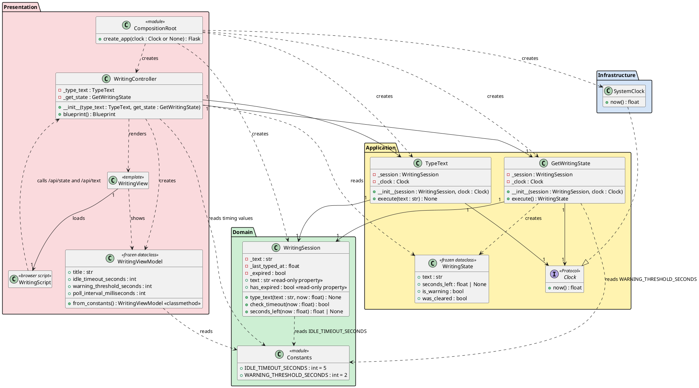
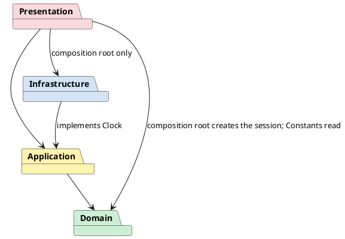

# Design Class Diagram for UC-001

## Metadata
| Key | Value |
| --- | --- |
| ID | DCD-001 |
| CrossReference | [DM-001], [OC-001], [SD-001], [SA-001] |

## Version History
| Date | Status | Author | Reviewer | Change | Commit |
| --- | --- | --- | --- | --- | --- |
| 2026-11-20 | Deprecated | Jens Tirsvad Nielsen | S01 | Initial version | [99eebd6] |
| 2026-11-20 | Accepted | Jens Tirsvad Nielsen | S01 | Presentation layer designed for MIL-003: CompositionRoot, WritingController, WritingViewModel, WritingView and WritingScript replace the boundary placeholders; package Delivery renamed Presentation | pending |

---

## Purpose and Scope

This diagram turns the sequence diagrams of [SD-001] into design classes for UC-001, in the four layers of Clean Architecture, under `src/disappearing_text/`. It answers concern CN-001 (text must disappear after more than 5 seconds without typing), CN-003 (tests protect the session rules) and CN-004 (readable code with the assignment's function names) of [SA-001], and serves S01 and S02. No project Design Class Diagram exists yet, so every class here is new. The Presentation layer is the package `disappearing_text.presentation`, drawn in the colour the framework fixes for the Delivery layer. It is designed here in MIL-003. The web page follows MVVM, the default of the clean-architecture skill for a user interface: the view is the template `WritingView` with the browser script `WritingScript`, the view model is `WritingViewModel`, and `WritingController` maps HTTP requests to the two use cases; `CompositionRoot` builds the Flask application and connects the parts.

## Diagram

Package dependencies (all point inward; the interface `Clock` is owned by Application and implemented in Infrastructure):

## Class Table

| Class | Refines (Domain Model concept) | Responsibility | Attributes | Operations |
| --- | --- | --- | --- | --- |
| WritingSession | Writing Session; its attributes `_text` and `_last_typed_at` refine Text and last typing moment, `_expired` refines text lost | Holds the Text and decides when it is deleted, given the time it is told | `-_text`, `-_last_typed_at`, `-_expired` | `+type_text`, `+check_timeout`, `+seconds_left`, `+text`, `+has_expired` |
| Constants | Idle Timeout (length in seconds, warning period in seconds); module of constants, not a class with instances | Holds the Idle Timeout and the warning period in one place | `+IDLE_TIMEOUT_SECONDS`, `+WARNING_THRESHOLD_SECONDS` | none |
| Clock | None: technical port | States what the use cases need from time: the current moment in seconds | none | `+now` |
| TypeText | None: technical use case object | Carries the system operation `type_text` from the Presentation to the Writing Session | `-_session`, `-_clock` | `+__init__`, `+execute` |
| GetWritingState | None: technical use case object | Carries the system operation `get_state`: checks the timeout, then builds the answer | `-_session`, `-_clock` | `+__init__`, `+execute` |
| WritingState | None: data transfer object for the state of the Writing Session (Text, seconds left, Warning, Text was cleared) | Carries the state to the Presentation | `+text`, `+seconds_left`, `+is_warning`, `+was_cleared` | none |
| SystemClock | None: technical adapter | Implements `Clock` with the monotonic system clock | none | `+now` |
| WritingController | None: technical adapter of the web delivery mechanism | Maps three HTTP routes to the two use cases and the page; returns only `WritingState` values mapped to plain dictionaries, never a domain object; a request with a body that is not JSON, or with `text` that is not a string, is answered with 400 | `-_type_text`, `-_get_state` | `+__init__`, `+blueprint` |
| WritingViewModel | None: technical view model (MVVM) | Holds what the page needs and does not get from the state: the title and the three timing values, built from the constants | `+title`, `+idle_timeout_seconds`, `+warning_threshold_seconds`, `+poll_interval_milliseconds` | `+from_constants` |
| WritingView | None: technical view (MVVM), the Jinja template `writing_view.html` | Draws the single screen of the wireframe: text area, countdown, status message for the states empty, typing, warning and text gone | none | none |
| WritingScript | None: technical view behaviour, the file `writing.js` (with `writing.css` for the style) | Sends the text of the text area to the controller on every input; asks for the state every `poll_interval_milliseconds`; shows the seconds left and the warning; empties the text area and shows "Your text is gone" only when `was_cleared` is true; ignores an answer to a state request that was started before the latest input, so a late answer cannot erase freshly typed text | none | none |
| CompositionRoot | None: technical module (`composition_root.py`), the composition root | Creates one Writing Session, the `SystemClock` when no clock is given, both use cases, the controller and the Flask application (templates and static files under `presentation/features/writing/`) | none | `+create_app` |

The entry point `src/disappearing_text/__main__.py` is a script outside the four layers and not a class: it calls `create_app()` and runs the result on `DEFAULT_HOST` and `DEFAULT_PORT` of the constants with debug off. `WritingViewModel.from_constants` uses the title of the wireframe, "Write without stopping", as its one literal; the three numbers come from the Constants module.

The routes of `WritingController`:

| Route | Request | Answer | Calls |
| --- | --- | --- | --- |
| `GET /` | none | HTML from `writing_view.html`, rendered with a `WritingViewModel` | none: no system operation |
| `GET /api/state` | none | 200, JSON with `text`, `seconds_left`, `is_warning`, `was_cleared` (from `WritingState`) and `idle_timeout_seconds`, `warning_threshold_seconds`, `poll_interval_milliseconds` (from the constants) | `GetWritingState.execute()` |
| `POST /api/text` | JSON `{"text": str}` | 200, the same JSON as `GET /api/state`; 400 with `{"error": "..."}` for a body that is not a JSON object, a missing `text` or a `text` that is not a string | `TypeText.execute(text)`, then `GetWritingState.execute()` |

Idle Timeout and Text are not classes of their own. Idle Timeout has two values and no behaviour, so it is two constants; Text is the one string `_text` that the Writing Session owns. Neither is dropped: the table above shows where each lives.

## Method Traceability

| Method signature | Operation Contract / SD message |
| --- | --- |
| `WritingSession.type_text(text : str, now : float) : None` | `type_text` in [OC-001]; message `type_text(text, now)` in sequence type_text of [SD-001] |
| `WritingSession.check_timeout(now : float) : bool` | `get_state` in [OC-001] (the internal check); message `check_timeout(now)` in sequence get_state of [SD-001] |
| `WritingSession.seconds_left(now : float) : float or None` | `get_state` in [OC-001], `seconds_left`; message `seconds_left(now)` in sequence get_state |
| `WritingSession.text : str` | `get_state` in [OC-001], `text`; message `text` in sequence get_state |
| `WritingSession.has_expired : bool` | `get_state` in [OC-001], `was_cleared`; message `has_expired` in sequence get_state |
| `TypeText.execute(text : str) : None` | `type_text` in [OC-001]; message `execute(text)` in sequence type_text |
| `GetWritingState.execute() : WritingState` | `get_state` in [OC-001]; message `execute()` in sequence get_state |
| `Clock.now() : float` and `SystemClock.now() : float` | message `now()` in sequences type_text and get_state |
| `TypeText.__init__` and `GetWritingState.__init__` | message `create(session, clock)` in sequence composition at start |
| `CompositionRoot.create_app(clock : Clock or None) : Flask` | message `create_app(clock)` and the `create` messages in sequence composition at start of [SD-001] |
| `WritingController.__init__(type_text : TypeText, get_state : GetWritingState)` | message `create(type_text, get_state)` in sequence composition at start |
| `WritingController.blueprint() : Blueprint` | route `POST /api/text` forwards `type_text` of [OC-001] (message `execute(text)` in sequence type_text); route `GET /api/state` forwards `get_state` of [OC-001] (message `execute()` in sequence get_state); route `GET /` has no contract: it shows the page of the wireframe |
| `WritingViewModel.from_constants() : WritingViewModel` | no contract and no SD message: it carries constants to the page; its fields serve the states of `wireframe.md` of UC-001 |
| `WritingState` fields | `create(text, seconds_left, is_warning, was_cleared)` in sequence get_state; return of `get_state` in [OC-001] |

## Pattern Annotations

| Pattern | Classes | Rationale |
| --- | --- | --- |
| Ports and Adapters (Dependency Inversion) | `Clock`, `SystemClock` | Application owns the interface; Infrastructure implements it, so tests use a fake clock |
| Controller (GRASP) | `TypeText`, `GetWritingState` | Each receives one system operation and coordinates, without holding the rule |
| Information Expert (GRASP) | `WritingSession` | It owns the data the timeout rule needs |
| Data Transfer Object | `WritingState` | A frozen value hides the domain object from the Presentation |
| Dependency Injection | `CompositionRoot`, `TypeText`, `GetWritingState`, `WritingController` | One shared `WritingSession` and the clock are passed in, and the use cases are passed to the controller; the optional `clock` of `create_app` lets a test pass a fake clock; this is not a Singleton, because no class enforces a single instance |
| Model-View-ViewModel (MVVM) | `WritingView`, `WritingScript`, `WritingViewModel`, `WritingController` | The default pattern of the clean-architecture skill for a user interface: the view is the template and the browser script, the view model is `WritingViewModel`, the controller maps HTTP to the use cases; the view holds no rule |
| Application Factory (GoF Factory Method, as Flask names it) | `CompositionRoot.create_app` | Builds a new Flask application with its parts on every call, so each test gets its own session |
| Controller (GRASP) | `WritingController` | Receives the HTTP requests, the system events of the web delivery mechanism, and forwards them to the use cases |
| Pure Fabrication (GRASP) | `SystemClock`, `Constants` | They have no Writer-world meaning and keep time and numbers out of the rules |

## Dependency Check

Every dependency points inward: Presentation depends on Application and Domain, Application depends on Domain, and Infrastructure depends on Application through the `Clock` interface, which Application owns. The Domain classes depend only on the Constants module in the same layer: `WritingSession` imports no Flask and no clock. The Presentation to Infrastructure arrow exists only for `CompositionRoot`, which creates `SystemClock`; no other Presentation class uses it. The Presentation to Domain arrow exists for `CompositionRoot`, which creates `WritingSession`, and for `WritingController` and `WritingViewModel`, which only read the Constants module; they never hold or return a `WritingSession`, so no domain object crosses the boundary to the browser. The template and the script are not Python classes: the script reaches the controller only over HTTP. There are no circular dependencies between classes or packages. SOLID: every class has one responsibility, `TypeText` and `GetWritingState` are split so that neither does two jobs, and the use cases depend on the `Clock` abstraction, not on `SystemClock`.

---

[DM-001]: ./dm.md
[OC-001]: ./oc.md
[SD-001]: ./sd.md
[SA-001]: ../../stakeholder-analysis.md
[99eebd6]: https://git.tirsystem.com/Tirsvad-Udemy-100-days-of-code/090-assignment-disappearing-text-writing-app/commit/99eebd69b73173ca68a4d9676c39855a30cdf1b9
