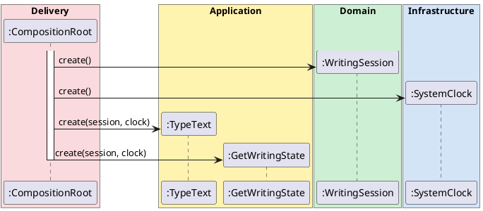
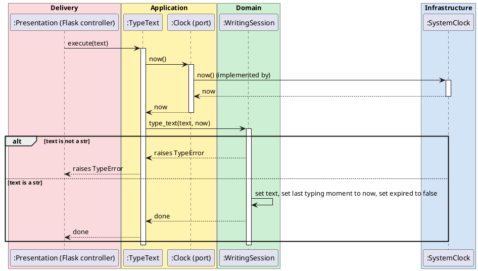
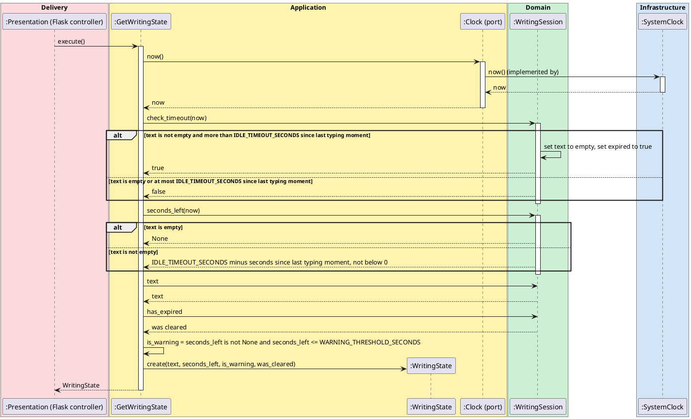

# Sequence Diagrams for UC-001

## Metadata
| Key | Value |
| --- | --- |
| ID | SD-001 |
| CrossReference | [OC-001], [SA-001], [DCD-001] |

## Version History
| Date | Status | Author | Reviewer | Change | Commit |
| --- | --- | --- | --- | --- | --- |
| 2026-11-20 | Deprecated | Jens Tirsvad Nielsen | S01 | Initial version | pending |
| 2026-11-20 | Accepted | Jens Tirsvad Nielsen | S01 | Added the CrossReference to DCD-001, now that it exists | pending |

---

## Purpose

These diagrams show how the objects of UC-001 collaborate to realize the contracts `type_text` and `get_state` of [OC-001]. They answer concern CN-001 (text must disappear after more than 5 seconds without typing), CN-003 (tests protect the session rules) and CN-004 (readable code with the assignment's function names) of [SA-001], and serve S01, who decides the design, and S02, who reads it. The design is layered (Clean Architecture): Delivery, Application, Domain and Infrastructure, in the colours the framework fixes. The Delivery layer is only drawn as the boundary "Presentation (Flask controller)" that calls the use cases; its design belongs to MIL-003. Every call across a layer boundary goes through an interface of the inner layer: the use cases call the `Clock` port, which `SystemClock` implements in the Infrastructure layer; the diagrams draw the port as its own lifeline in the Application layer.

The mapping from system operation to class is: `type_text` is `TypeText.execute(text)`, and `get_state` is `GetWritingState.execute()`. The internal check of the Idle Timeout, `check_timeout`, is a method of `WritingSession` that `GetWritingState` calls.

## Sequence: composition at start

**Realizes:** the precondition shared by both contracts in [OC-001]: a Writing Session exists, and the Presentation and the use cases use that one instance. The composition root creates it once at start and passes it to both use cases.

### Diagram

### Pattern Annotations

| Pattern (GRASP / GoF) | Applied to | Rationale |
| --- | --- | --- |
| Creator (GRASP) | `CompositionRoot` creates `WritingSession`, `SystemClock` and both use cases | It is the one place that knows all the parts, so the inner layers never create outer ones |
| Dependency Injection | `WritingSession` and the clock are passed to both use cases | The use cases share one session and never build a clock themselves, so tests pass a fake clock |

### Postcondition Coverage

| Postcondition (from contract) | Satisfied by message |
| --- | --- |
| Precondition of both contracts: a Writing Session exists, with a Text and an Idle Timeout | `create()` of `WritingSession` (it starts with empty Text, text lost false, and the Idle Timeout constants) |

### Responsibility Check

The composition root only creates and connects objects; it holds no rule.

## Sequence: type_text

**Realizes:** `type_text` in [OC-001]

### Diagram

### Pattern Annotations

| Pattern (GRASP / GoF) | Applied to | Rationale |
| --- | --- | --- |
| Controller (GRASP) | `TypeText` | A use case object receives the system operation from the Presentation and coordinates, without holding a rule |
| Information Expert (GRASP) | `WritingSession` | It owns the Text, the last typing moment and the Idle Timeout, so it applies the change itself |
| Ports and Adapters (Dependency Inversion) | `Clock` port, `SystemClock` adapter | The Application layer depends on an interface; the monotonic system clock is an Infrastructure detail |
| Pure Fabrication (GRASP) | `SystemClock` | A class with no domain meaning, made to keep the clock out of the domain |

### Postcondition Coverage

| Postcondition (from contract) | Satisfied by message |
| --- | --- |
| Text.words was set to `text` | `type_text(text, now)`, self-message "set text" |
| WritingSession.last typing moment was set to the current moment | `now()` returns the moment, and `type_text(text, now)` stores it |
| WritingSession.text lost was set to false | `type_text(text, now)`, self-message "set expired to false" |
| No instance was created or deleted | No `create` or `destroy` message in this diagram |
| Exception: `text` is not text | `alt` branch "text is not a str": the error is raised and no state is changed |

### Responsibility Check

`TypeText` only reads the clock and delegates; the rule is in `WritingSession`. No object receives every message.

## Sequence: get_state

**Realizes:** `get_state` in [OC-001], including the internal operation `check_timeout`

### Diagram

### Pattern Annotations

| Pattern (GRASP / GoF) | Applied to | Rationale |
| --- | --- | --- |
| Controller (GRASP) | `GetWritingState` | Coordinates the clock, the session and the answer for the Presentation |
| Information Expert (GRASP) | `WritingSession.check_timeout`, `seconds_left` | The session knows the last typing moment and the Text, so it decides when the Text is deleted and how many seconds are left |
| Data Transfer Object | `WritingState` | A frozen value that carries the state to the Presentation, so the Presentation never touches the domain object |
| Ports and Adapters (Dependency Inversion) | `Clock` port, `SystemClock` adapter | The domain receives time as a number and has no clock |
| Low Coupling (GRASP) | `WritingSession` | It takes `now` as a parameter, so it imports no clock and no framework |

### Postcondition Coverage

| Postcondition (from contract) | Satisfied by message |
| --- | --- |
| More than the Idle Timeout since last typing moment and Text not empty: Text empty and text lost true | `alt` branch of `check_timeout(now)`, self-message "set text to empty, set expired to true" |
| Exactly the Idle Timeout or fewer seconds passed: Text kept | `else` branch of `check_timeout(now)`; nothing changes |
| Text empty: nothing changed | `else` branch of `check_timeout(now)`; nothing changes |
| `text` equals Text.words | `text` read from `WritingSession` and passed to `create` of `WritingState` |
| `seconds_left` is the timeout minus elapsed, not below zero, none when no Text | `seconds_left(now)` with its two branches |
| `is_warning` true when Text not empty and `seconds_left` at most the warning period | self-message `is_warning = ...` in `GetWritingState` |
| `was_cleared` equals text lost | `has_expired` read from `WritingSession` and passed to `create` of `WritingState` |
| No instance of the domain created or deleted | Only the `WritingState` value is created, which is not a Domain instance |
| Exception: no Writing Session | Not drawn: the composition at start creates it before any message, as the contract says |

### Responsibility Check

The Application object coordinates and builds the answer. The session alone changes state and decides the timeout. The clock is the only object that knows real time. No object receives all messages.

---

[OC-001]: ./oc.md
[SA-001]: ../../stakeholder-analysis.md
[DCD-001]: ./dcd.md
