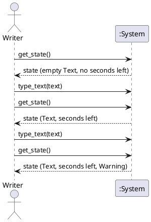
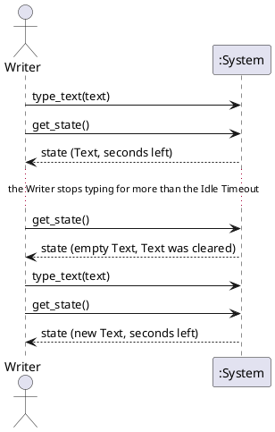

# System Sequence Diagram for UC-001

## Metadata
| Key | Value |
| --- | --- |
| ID | SSD-001 |
| CrossReference | [UC-001], [DM-001], [OC-001] |
| Language | en |
| Domain | it |

## Version History
| Date | Status | Author | Reviewer | Change | Commit |
| --- | --- | --- | --- | --- | --- |
| 2026-11-20 | Deprecated | Jens Tirsvad Nielsen | S01 | Initial version | [99eebd6] |
| 2026-11-20 | Accepted | Jens Tirsvad Nielsen | S01 | Added the CrossReference to OC-001, now that it exists | [99eebd6] |

---

## Source Use Case

Write without stopping ([UC-001]) — scenario 1: main success scenario (steps 1 to 9). Scenario 2 is the extension 6a, the Writer stops for more than the Idle Timeout. The extension 6b, the Writer deletes all of the Text by hand, sends the same message as step 6 with an empty Text and needs no diagram of its own.

## Diagram

Scenario 1: main success scenario.

Scenario 2: extension 6a, the Writer stops for more than the Idle Timeout.

## System Operations

The system has two operations. The check of the Idle Timeout is not a message from the Writer: the system makes it when the state is read, and it is therefore an internal step shown in the Sequence Diagram, not here.

| Step | Message | Parameters | Return | Use case step |
| --- | --- | --- | --- | --- |
| 1 | get_state | none | state: Text, seconds left (none when there is no Text), Warning, Text was cleared | 1, 2 |
| 2 | type_text | text: the full Text as it is now | nothing | 3, 4 |
| 3 | get_state | none | state, with seconds left | 5 |
| 4 | type_text | text: the full Text as it is now | nothing | 6, 7 |
| 5 | get_state | none | state, with the Warning set when 2 seconds or less are left | 8 |
| 6 (scenario 2) | get_state | none | state with empty Text and Text was cleared | 6a.1, 6a.2 |
| 7 (scenario 2) | type_text | text: the first new Text | nothing | 6a.3, 6a.4 |

The Writer repeats steps 4 and 5 until done (step 9 of the use case). The messages follow the main success scenario of the use case one to one. The use case shows the display of the seconds left (step 5) and of the Warning (step 8) as system responses; they are the returns of `get_state`, because the system answers only when it is asked. Step 6a.1, the deletion, has no message of its own, because the system makes it when the state is read after the Idle Timeout has passed.

## Lifecycle Notes

The system holds one Writing Session for the one Writer it serves; it is created when the system starts and is not destroyed between messages. After the Text has been deleted, the Writing Session stays and shows that the Text was cleared until the next `type_text`. This follows the decision of ADR-0002 that the app serves one Writer at a time.

---

[UC-001]: ./uc.md
[DM-001]: ./dm.md
[OC-001]: ./oc.md
[99eebd6]: https://git.tirsystem.com/Tirsvad-Udemy-100-days-of-code/090-assignment-disappearing-text-writing-app/commit/99eebd69b73173ca68a4d9676c39855a30cdf1b9
